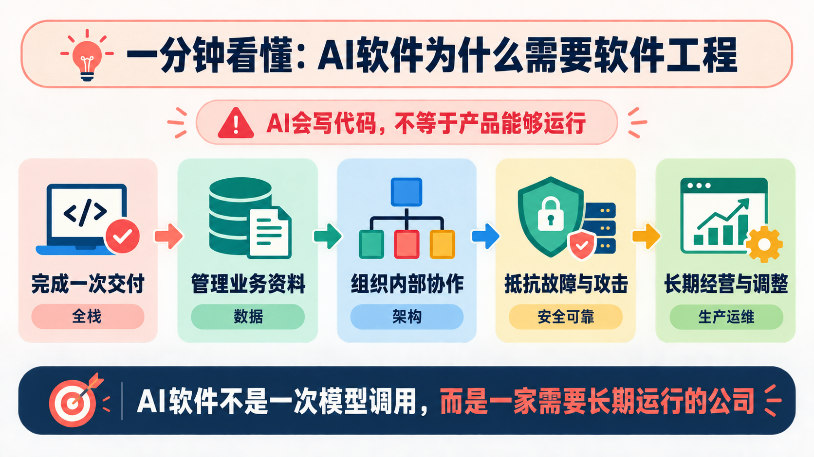
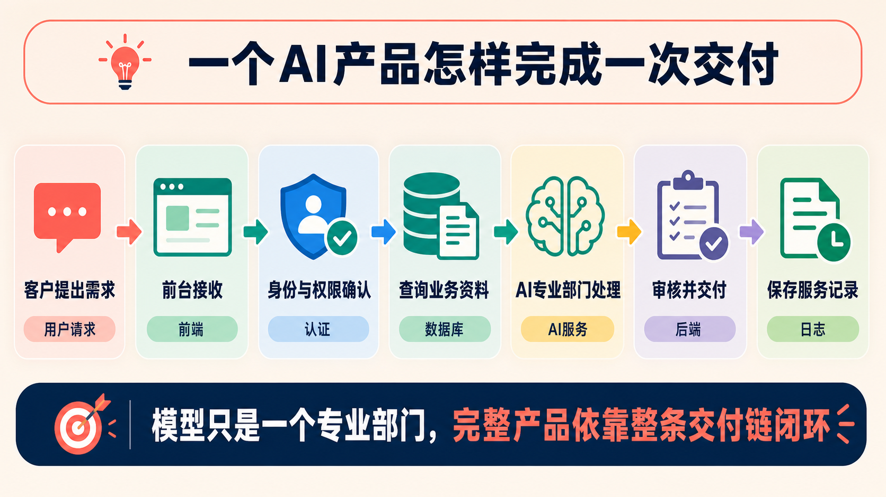
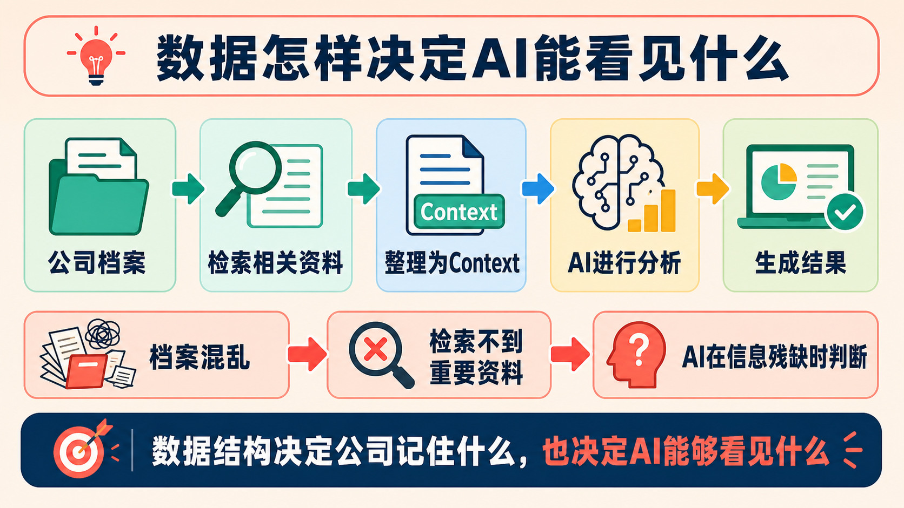
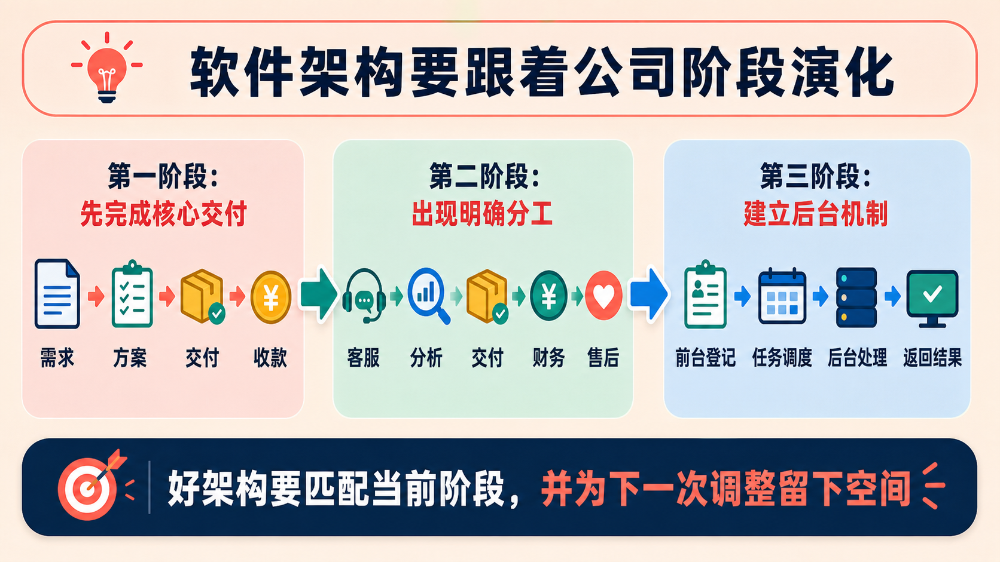
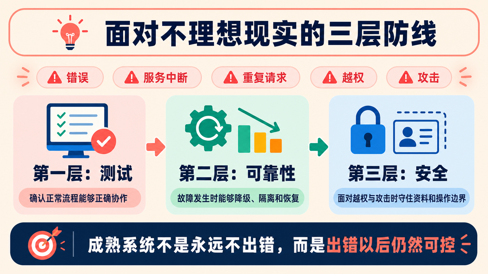
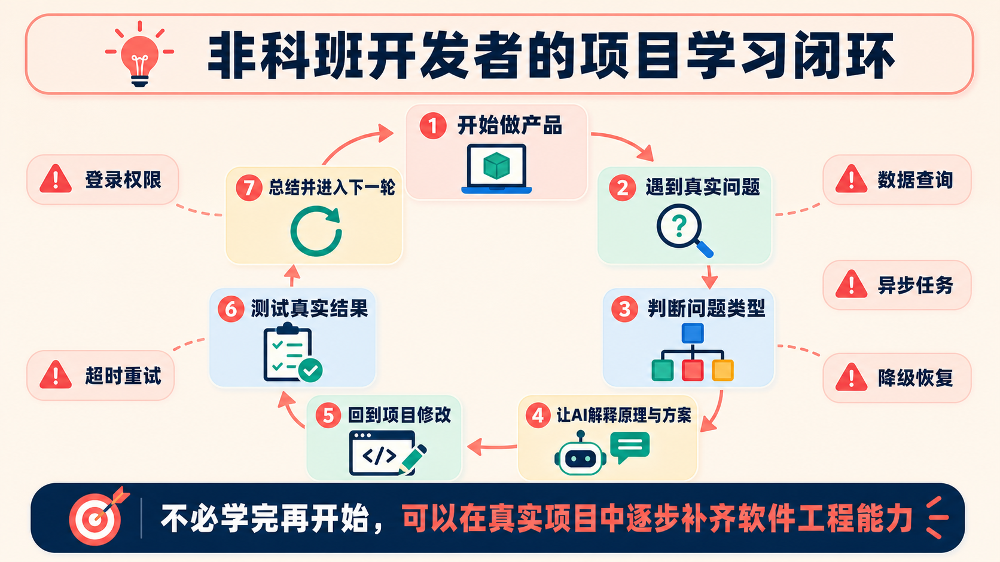

# AI已经会写代码了，非科班开发者为什么还要懂软件工程？

## ——读完吴恩达在X上的一条推文，我用一家正在运行的公司重新理解了AI软件

如果你正在使用Coding Agent做产品，却因为自己不是科班开发者，不知道还要不要补软件工程，这篇文章就是写给你的。

它不会要求你先学完前端、后端、数据库、测试和运维再开始做产品。读完后，你至少会得到一张判断地图：怎样看一个AI软件是否形成了完整闭环，数据有没有组织好，各部分能否稳定协作，出现故障时有没有退路，上线后能不能长期运行。

你还会知道，下一次让Agent写功能时，除了问“能不能实现”，还应该检查哪些数据、权限、失败风险和运行条件；当项目真的遇到问题时，又该补哪一类知识。

我的核心判断是：

> ==**AI正在降低代码实现成本，但软件工程能力决定了你能否把AI能力组织成真正可运行、可维护、可演化的产品。**==

这个判断不是凭空产生的。

最近，我读完了吴恩达发布在X上的一篇文章：

> AI Engineering Skills Map: Software engineering fundamentals

也就是“AI工程技能地图：软件工程基础”。

他讨论的不是如何调用大模型，而是一个更基础的问题：当Coding Agent已经可以替人写越来越多代码时，为什么软件工程基础仍然重要？

吴恩达在文中提出了五个方向：构建全栈应用、管理数据、设计系统架构、构建安全可靠的系统，以及让系统在生产环境中扩展和长期运行。

一开始，我把它们理解成一份技术学习清单。读完之后，我却逐渐产生了另一种理解：**一个正在运行的AI软件，很像一家正在运营的公司。**

这里不是说公司和软件完全相同，而是说它们需要解决一组相似的问题：

```text
完成一次交付
↓
管理好业务资料
↓
组织内部协作
↓
抵抗故障和外部冲击
↓
长期经营并持续调整
```



沿着这条线，我们就能用一种更接近现实经营的方式，看懂吴恩达列出的五项软件工程能力。

## 一、吴恩达讲的不是技术清单，而是人的职责发生了变化

吴恩达给出的关键提醒是：即使Coding Agent替你完成代码实现，你仍然要引导它做出符合项目实际情况的取舍。

这里的关键词是tradeoff，也就是权衡。

一个软件系统永远不可能同时做到：

- 成本最低；
- 速度最快；
- 可靠性最高；
- 结构最简单；
- 扩展性最强；
- 安全性最好。

很多时候，你必须根据具体情况做选择。

这让我想到一家正在运营的公司。

公司负责人可以让AI帮助自己制定流程、整理客户资料、设计部门制度，甚至草拟各种文件。

但AI并不知道这家公司真正的情况：

- 公司的核心业务是什么；
- 客户最看重什么；
- 哪些资料绝对不能泄露；
- 哪些流程必须保留人工审核；
- 哪些部门之间需要紧密协作；
- 哪些环节出现问题会影响整个公司；
- 公司现在更需要速度、质量还是成本控制。

如果负责人自己不知道这些问题，AI就可能帮他设计出一套看起来完整、实际上并不适合公司的制度。

软件系统也是一样。

Coding Agent可以帮你生成页面、接口、数据库、AI调用、登录功能和测试代码。但在生成这些内容的同时，它也可能隐含地替你决定：

- 数据应该怎样组织；
- 用户权限如何划分；
- 哪些功能应该同步完成；
- 哪些任务应该交给后台处理；
- 一个服务失败后是否需要降级；
- 数据保存多久；
- 一个模块是否应该独立出来。

真正危险的情况，不一定是AI做错了一个决定。

更危险的是：

> ==**你根本不知道这里存在一个需要判断的问题。**==

吴恩达提到，缺少软件工程基础的人，很容易让Agent在延迟、可用性、一致性、可靠性、可维护性、简洁性和成本之间做出糟糕的权衡。

我理解这并不是在说非科班开发者不能使用AI。

而是在提醒我们：

> AI可以负责局部分析、提出方案和执行任务，但不能脱离人的目标与约束，替整家公司决定经营方向。

所以，软件工程基础的第一价值，不是让你亲手写更多代码，而是让你知道：

> ==**Agent正在替你做什么决定，这些决定会给系统带来什么后果。**==

## 二、为什么AI产品不只是一个模型调用——它更像一家公司

吴恩达把“构建全栈应用”列为软件工程的重要能力。

他还特别强调，AI核心通常只是更大软件应用中的一部分。

这一点非常容易被忽略。

很多人理解AI产品时，脑子里的流程是：

```text
用户提问
↓
调用模型
↓
返回答案
```

但如果把AI软件看成一家正在运营的公司，它实际的工作流程更像这样：

```text
客户提出需求
↓
前台接收需求
↓
确认客户身份
↓
查询客户资料
↓
分配给相关部门
↓
专业部门进行分析
↓
审核结果
↓
向客户交付
↓
保存本次服务记录
```

对应到软件中，就是：

```text
用户提出请求
↓
前端接收
↓
系统认证
↓
读取数据
↓
调用AI
↓
保存结果
↓
返回用户
```



为了避免后面把几个层级混在一起，我们先固定这套对应关系：

- 整个正在运行的AI软件，像一家公司；
- 你是需要确定目标、约束和风险底线的负责人；
- Coding Agent更像帮助你设计、建设和调整系统的执行团队，而不是公司内部正在运行的某个部门。

在这家公司内部：

- 前端像公司的服务窗口；
- 后端像处理业务的内部部门；
- API像部门之间约定好的交接单和沟通规则：谁提交什么信息，对方返回什么结果，填写错误时如何处理；
- 数据库像公司的档案部门；
- AI模型像负责局部分析和生成建议的专业部门；
- 权限系统像公司的门禁；
- 日志像公司的工作记录。

**一家公司真正完成一次客户交付，不是因为某个部门单独完成了任务，而是因为整个流程能够顺利闭环。**

AI产品也是如此。

模型回答得再好，如果：

- 用户无法登录；
- 权限混乱；
- 历史记录无法找到；
- 数据不能保存；
- 结果无法追踪；
- 某个模块或服务一出问题，整个系统就停止；

那么它仍然不是一个完整、可靠的产品。

这里的“全栈理解”，也不等于非科班开发者必须立刻成为前端、后端、数据库和运维专家。

更实际的要求是：

- 你知道用户从哪个界面进入系统；
- 你知道一次请求会经过哪些模块和服务；
- 你知道数据保存在哪里；
- 你知道结果如何返回和记录；
- 你知道某个模块出问题后会影响什么。

换句话说：

&nbsp;

> ==**你不一定亲自负责每个部门，但你要看得懂整家公司是怎样完成一次交付的。**==

## 三、数据不是后台细节，而是系统的记忆和AI的视野

吴恩达对数据管理强调得非常重。

**因为数据不是软件运行之后才附加上去的东西，而是整个软件建立在其上的基础。**

把数据理解成公司的长期记忆，会更容易一些。

一家公司的客户资料可能包括：

- 客户基本信息；
- 历史订单；
- 服务记录；
- 合同内容；
- 投诉记录；
- 当前负责人；
- 最近一次沟通时间；
- 尚未解决的问题。

如果这些内容散落在销售人员的聊天记录、客服的Excel、财务的邮件和管理者的个人笔记中，公司可能拥有很多信息，却无法真正使用这些信息。

当管理者想知道：

> 这个客户过去发生过什么？

可能要同时询问销售、客服、财务和项目负责人。

这家公司不是没有资料，而是没有把资料组织成可以快速查找和复用的结构。

软件中的数据问题也是这样。

如果数据设计不合理，可能出现：

- 同一个客户有多个名称；
- 不同订单无法对应到同一个客户；
- 历史记录无法追踪；
- 新旧资料混在一起；
- 信息无法按条件筛选；
- 数据出现重复或丢失。

AI应用还多了一层问题。

AI通常不是直接读取公司的全部资料，而是：

```text
公司档案
↓
检索相关信息
↓
整理成Context（这次交给AI参考的相关资料）
↓
交给AI分析
↓
生成结果
```



如果公司的档案管理混乱，AI就无法找到真正需要的信息。

这时，问题不一定是模型能力不足，而是：

> 公司没有把自己的记忆整理好。

所以，数据管理至少要回答这些问题：

- 哪些信息需要长期保存？
- 客户、订单、合同和服务记录之间是什么关系？
- 公司最常查询哪些资料？
- 哪些资料需要及时更新？
- 哪些资料可以被复用？
- 谁可以查看和修改？
- 数据保存多久？
- 数据出错以后能否恢复？

吴恩达提到，数据架构相对难以改变。

我对这句话的理解是：

> 公司业务可以调整，员工可以更换，流程可以重写，但已经积累的客户资料、历史关系和业务记录，很难轻易推倒重来。

因此，数据结构不是后台细节。

它决定了：

&nbsp;

> ==**公司记住什么，AI能够看到什么，以及AI可能不知道什么。**==

## 四、架构不是越复杂越先进，而是要匹配项目阶段

吴恩达在文章中提到，系统架构必须根据应用场景来设计，而且正确架构是一个不断变化的目标。

这让我联想到一家正在成长的公司。

公司刚开始经营时，最重要的是先跑通“需求—方案—交付—收款”这条核心链路。客户增加以后，客服、分析、交付、财务和售后才会逐渐形成明确分工。

这不意味着公司一开始的组织方式是错误的，只是业务发展以后出现了新的约束。

软件架构也是一样。

最开始，一个AI应用可能只需要：

```text
用户界面
↓
业务处理
↓
数据库
↓
AI服务
```

随着软件继续运行，可能出现：

- 数据查询越来越慢；
- 某类任务执行时间过长；
- 不同功能对资源的需求不同；
- 某个模块经常影响其他功能；
- 用户权限越来越复杂；
- 历史数据越来越难管理。

这时，系统就可能需要重新划分边界。

例如，如果一次AI分析需要很长时间，却仍然放在用户正在等待的请求中同步执行，页面可能迟迟没有结果，甚至直接超时。

更合理的流程可能是：

```text
用户提交请求
↓
系统记录任务
↓
任务队列调度
↓
后台程序处理
↓
通知用户结果
↓
保存处理记录
```

软件里的核心判断是：耗时工作不必让用户一直等待，可以先记录任务，再交给后台处理。工程师可能会使用任务队列和后台程序实现它，但小白现在不必先记住这些技术名称。

你可以先直接问Coding Agent：这个功能会不会让用户一直等待？任务失败后能否重试？处理完成后如何通知用户和保存结果？

**所以，架构设计不是提前把所有未来部门都建立起来。**

软件MVP不需要一开始就解决所有未来问题，但至少要让数据有明确归属、模块职责可以区分、关键流程能够追踪，并为后续调整留下空间。不能为了追求速度，就把所有业务逻辑、数据和权限混成一团。

成熟的架构思维不是：

> 现在就设计出系统最终的架构。

而是：

&nbsp;

> ==**知道当前系统为什么这样划分，也知道什么时候必须重新调整边界。**==



## 五、系统不能只为正常情况设计，还要为失败和攻击设计

吴恩达在推文中把测试、安全和可靠性放在一起讨论。

我理解它们共同解决的是一个问题：

> 一家公司在遇到异常时，能不能继续保持稳定？

这可以分成三个层次来看。

- 测试，确认正常流程和异常流程是否按预期工作；
- 可靠性，保证局部故障发生后，核心功能仍能继续；
- 安全，防止越权访问和恶意攻击突破系统边界。

### 先确认正常流程能否正确协作

测试首先要确认软件的主链路是否成立：

```text
用户提交请求
↓
身份与权限校验
↓
业务模块处理
↓
保存数据
↓
返回并记录结果
```

不仅要看每个模块能否完成自己的工作，还要看模块之间的数据能否正确交接，最终结果是否符合用户预期。

但只检查正常流程还不够。

### 再为故障和外部冲击准备退路

真实运行时一定会遇到异常：

- 用户重复提交请求；
- 某个后端服务暂时不可用；
- 支付系统无法确认结果；
- 外部模型或工具突然停止服务；
- 管理员发生误操作；
- 大量用户同时访问；
- 外部政策或接口规则突然变化。

如果系统没有应急机制，一次局部问题就可能影响全部业务。

比如，用户因为网络卡顿，连续提交了两次报销。

系统不能因此生成两笔报销记录。

又比如，AI客服功能暂时无法调用模型服务。

更合理的安排应该是：

```text
AI服务暂时不可用
↓
切换到人工处理或标准回复
↓
订单和其他核心业务继续运行
```

而不是：

```text
AI服务暂时不可用
↓
整个客户服务系统停止
↓
所有客户都无法得到处理
```

**这就是优雅降级。**

它的目标不是保证系统任何时候都百分之百正常，而是：

> 一个模块出问题时，不要让整个系统一起瘫痪。

因此，测试还要覆盖模块协作和异常流程：

- 多个模块协作时是否顺畅；
- 数据交接是否准确；
- 某个模块停止后其他模块能否继续；
- 异常情况下是否有备用流程。

对于AI软件来说，还要额外考虑：

- 模型回答不确定；
- 模型没有找到重要资料；
- AI调用外部工具失败；
- 模型服务超时；
- 模型供应商暂时不可用；
- AI输出格式不符合要求。

这些问题不要求非科班开发者现在就知道所有技术方案，但至少要意识到：模型调用失败时，产品不能只剩下一条报错信息。

### 最后守住攻击和越权的边界

安全问题仍然可以借用公司的门禁和资料权限来理解，但落到软件中，必须直接回答：谁能登录，谁能查看或修改哪些数据，密钥如何保护，高风险操作是否留下审计记录，以及权限是否能够及时收回。

测试关心流程是否正确，可靠性关心故障发生后能否继续运行，安全则关心有人越权或恶意攻击时，系统能否守住边界。三者都在帮助系统面对“不理想的现实”，但解决的问题并不相同。

因此，可靠性不是保证系统永远不出错，而是：

&nbsp;

> ==**当系统遇到错误、攻击和外部冲击时，仍然能够回退、隔离和恢复。**==



## 六、上线不是终点，系统还要长期运行并持续减少混乱

吴恩达在文章最后谈到生产环境、部署、可观测性、扩展和技术债务。

一家公司正式开业，并不代表经营已经完成；软件上线也不代表开发已经结束。真实用户、真实数据和真实故障，都会带来演示阶段没有出现的新问题。

### 先看见系统怎样运行

它还要持续回答：

- 有多少用户正在使用；
- 哪些功能最常用；
- 哪些环节最慢；
- 哪些服务最容易失败；
- 哪些数据增长最快；
- 哪些操作成本过高；
- 出问题以后如何找到原因。

公司依靠收入、现金流、客诉率和订单处理时间判断经营状态。软件也需要自己的运行指标：

- 请求量；
- 错误率；
- 响应时间；
- 资源使用情况；
- 数据库耗时；
- AI调用成本。

没有经营指标，公司管理者只能凭感觉做决定。

没有日志、监控和告警，开发者也只能凭感觉维护系统。

**所以，软件上线不是结束，而是：**

> 它开始接受真实用户、真实数据和真实环境检验的起点。

但看见问题只是第一步。

### 再整理运行中积累的混乱

软件运行得越久，新需求、临时方案、历史兼容、重复逻辑和模块依赖就越容易不断积累。长期运营因此还要回答另一个问题：怎样持续整理这些混乱？

我原本以为，一个成熟的软件或公司，应该能够长期运行而不增加混乱。

但后来我意识到，这是不可能的。

只要软件继续迭代，技术债务就会积累。临时代码越来越多、同一逻辑被重复实现、一个小改动牵动多个模块，这些都是结构性混乱正在增加的迹象，也可以把它理解为一种“熵增”。

软件中的重构、代码审查、依赖维护、技术债务管理和事故复盘，就是在持续整理这些混乱。

小白可以先问Coding Agent：哪些逻辑正在重复？哪些临时方案已经影响新功能？哪些依赖一旦修改就容易牵连其他模块？哪些事故需要留下复盘和测试？

所以我现在更愿意这样理解：

&nbsp;

> ==**成熟系统不是完全没有混乱，而是能够持续发现、整理并减少运行中积累的混乱。**==

## 七、非科班开发者不要灰心，先看懂地图，再边做边补

看到这里，你可能会觉得软件工程需要掌握的内容太多了：

- 全栈；
- 数据；
- 架构；
- 测试；
- 安全；
- 部署；
- 监控；
- 扩展；
- 技术债务。

如果你是正在使用Coding Agent做产品的非科班开发者，不要因此灰心。

这篇文章并不是要求你现在立刻成为：

- 资深后端工程师；
- 数据库专家；
- 运维工程师；
- 安全工程师；
- 分布式系统专家。

你现在首先需要做的是：

> ==**先知道这些能力分别在解决软件运行中的什么问题。**==

- 全栈，解决产品能不能完成一次完整交付；
- 数据，解决业务资料能不能保存、关联和复用；
- 架构，解决模块和服务如何分工、协作和调整；
- 安全可靠，解决系统遇到故障、攻击和外部冲击时能否保持可控；
- 生产运维，解决产品上线后能否被观察、维护并长期运行。

先知道这些东西存在，就已经很重要了。

**之后，你可以一边做项目，一边利用AI补齐能力。**

```text
先做一个AI产品
↓
遇到登录问题
↓
学习身份认证和权限
↓
回到项目中修改
↓
遇到资料查询问题
↓
学习数据结构和数据访问
↓
回到项目中优化
↓
遇到任务执行时间太长
↓
学习异步处理
↓
回到项目中改进
↓
遇到服务不稳定
↓
学习超时、重试和降级
```



在这套类比中，你是这家软件公司的负责人；Coding Agent是帮助你设计、建设和调整系统的执行团队，而不是运行中的某个部门。你要逐渐学会确定产品目标、模块边界、数据权限和风险底线。

使用Agent时，不要只说：

> 帮我把这个功能写出来。

还可以继续追问：

- 这个功能属于哪个模块，边界在哪里？
- 它需要读取和保存哪些数据，谁可以访问？
- 它依赖哪些模块、接口或外部服务？
- 如果它暂时无法工作，其他功能能否继续？
- 它会不会访问不该访问的数据或执行越权操作？
- 用户和数据增加之后，哪里可能成为瓶颈？
- 需要哪些测试、日志和指标来确认它运行正常？

你不需要一次性回答所有问题。但每做完一个项目，你都应该比上一次更清楚：

&nbsp;

> ==**这个软件怎样完成交付，为什么这样组织，以及它可能会怎样失败。**==

## 结语：吴恩达给我的不是一张考试卷，而是一张地图

读完吴恩达这条X推文之后，我重新理解了软件工程。

它不只是记住更多语法、学会更多框架，也不只是写出更多代码、调用更强的模型。软件工程更像是在治理一家正在运营的公司。

这家公司首先要完成第一笔交付，形成业务闭环；要管理好客户资料和长期档案；要让各个部门之间稳定协作；要能够面对政策变化和外部冲击；还要在业务扩大、流程变复杂之后继续经营下去。

一个AI软件也是如此。它不能只在演示时运行，还要在真实用户、真实数据、真实故障和真实成本面前保持可控。这也是为什么，AI会写代码以后，软件工程并没有失去价值。

如果你是非科班开发者，不需要先把所有软件工程知识学完。先知道哪些问题存在，再在真实项目中借助AI逐步补齐，就是一条可以开始的路。

不要把软件工程当成开始做AI产品之前必须通过的考试。

把它当成一张地图。

它会告诉你：这家软件公司如何完成交付，资料放在哪里，各部分怎样协作，遇到风险如何回退，又怎样在长期运行中持续调整。

最后，我想用两句话概括读完吴恩达文章后的最大感受：

&nbsp;

> ==**AI负责越来越多的实现，人负责越来越多的判断。**==

> ==**而软件工程，就是支撑这些判断的知识底座。**==
