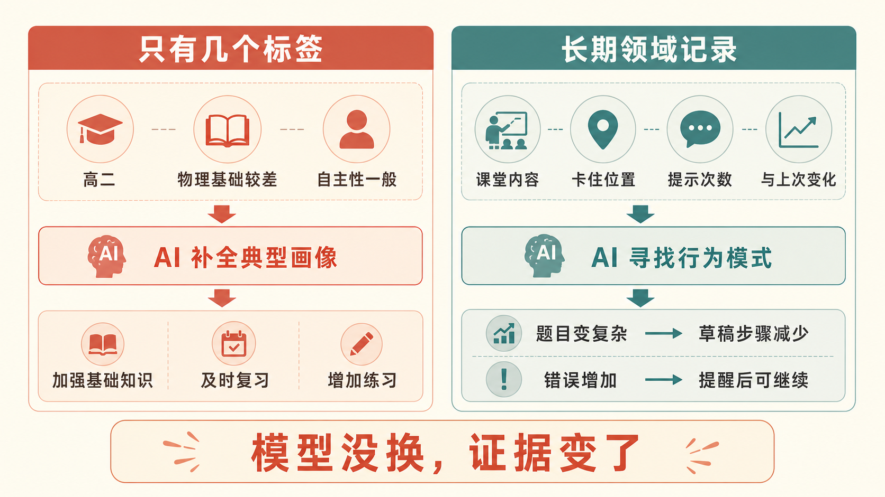
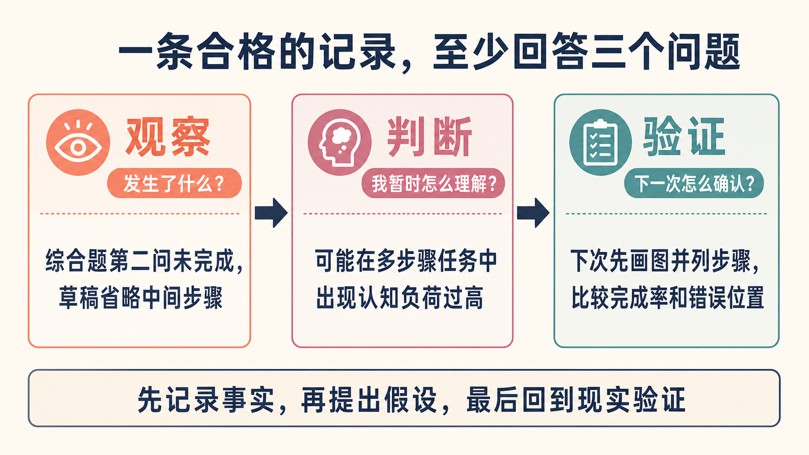
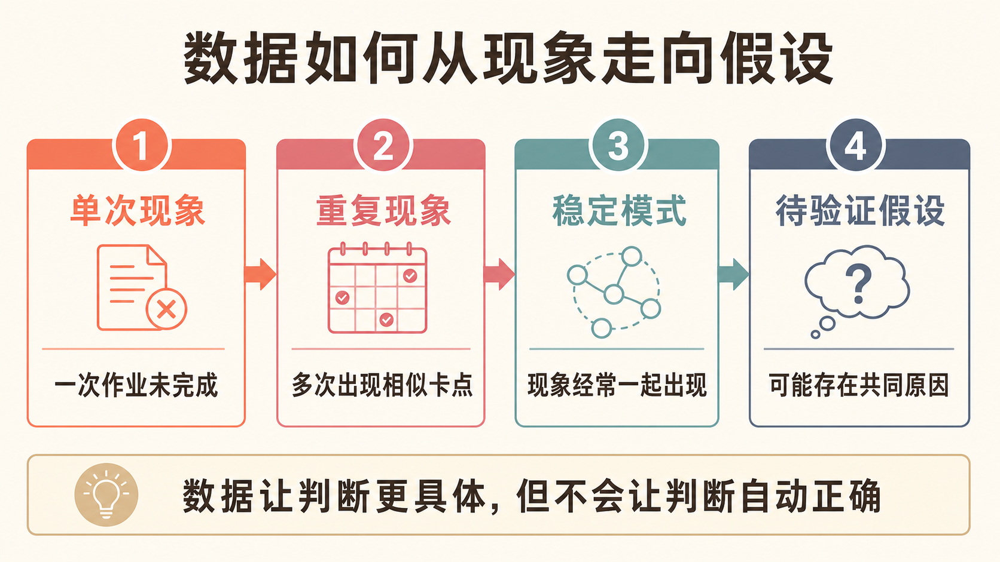
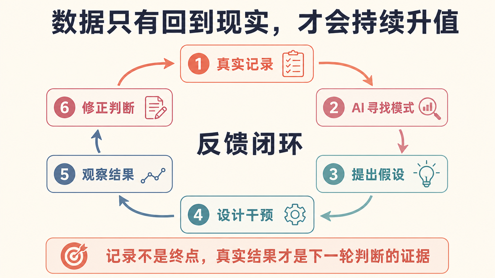

# 同一个 AI，为什么前后像换了一个模型？

==**当我开始记录每一次课堂表现，AI 对学生的分析发生了质变。真正发生变化的不是模型，而是它终于有了可以分析的证据。**==

前段时间，我开始把学生每次上课的情况记录下来。

不是只写“今天状态不错”“基础比较差”这种结论，而是尽量记下具体发生了什么：学了什么内容，在哪一步开始卡住，哪些题可以独立完成，接受几次提示后能够继续，作业完成了多少，以及和上一次相比发生了什么变化。

**记录积累到一定程度之后，我发现了一件很有意思的事：同一个 AI，对同一个学生的分析，前后像换了一个模型。**

这里的“像换了一个模型”只是对输出体验的描述，模型本身并没有真的更换。==**变化来自一件更基础的事：AI 得到的材料变了。**==



## 只有几个标签时，AI 只能猜一个“典型学生”

以前我只告诉 AI：

> 这个学生高二，物理基础较差，自主性一般，请分析一下他的学习情况。

AI 给出的回答通常没有错，却也几乎没有决策价值：加强基础知识、培养学习兴趣、及时复习、增加练习。

**这些话之所以听起来合理，是因为它们适用于很多基础薄弱的学生。**但它们没有回答一个更重要的问题：眼前这个学生，具体卡在哪里？

AI 不知道“基础差”究竟是概念不清、计算不稳，还是一遇到多步骤问题就无法维持解题过程；也不知道“不主动”是在所有任务中都存在，还是只在题目变难之后出现。

在信息不足时，AI 只能调用自己见过的常见模式，补全一个“典型的基础薄弱学生”。

所以，很多 AI 分析的问题不是完全错误，而是过于一般。它说的是一个大概率正确的类型，却不是这个具体对象的真实情况。

==**Prompt 可以改善表达，但不能凭空创造事实。**==没有真实材料，提示词再精巧，也很难让 AI 产生真正个性化的判断。

## 记录越具体，AI 才越有机会看见行为模式

后来，当我把一段时间的课堂记录交给 AI，回答开始具体得多。

它不再只说“计算能力差”，而是能够从多次记录中看到类似这样的变化：简单计算基本正常，题目一复杂就开始减少草稿步骤，随后错误明显增加；提醒之后，又能重新进入状态。

这时，我们才有可能提出一个更具体的假设：问题也许不只是计算能力，而是面对多步骤问题时，认知负荷增加，导致解题过程失控。

**注意，这仍然只是一个假设，不是诊断。**它的价值在于把下一步观察和干预变得更具体。

一条合格的记录，至少应该尽量回答四个问题：

```text
发生了什么？
哪里卡住了？
我暂时怎么判断？
下一次准备验证什么？
```

例如：

```text
观察：综合题第二问没有完成，草稿中省略了中间步骤。
判断：可能在多步骤任务中出现认知负荷过高。
验证：下次要求先画图并列出步骤，比较完成率和错误位置。
```

“没有画图”是观察；“认知负荷过高”是判断；“下次要求先画图”是验证方案。==**把这三者分开，AI 才不会把我的推测直接当成事实。**==



## 数据多不等于数据好

这里需要修正一个常见误解：==**不是记录得越多，AI 就一定越聪明。**==

如果每次只记录“今天还可以”“表现一般”“状态不好”，即使积累几百条，价值也很有限。因为这些话过于抽象，缺少可以比较的维度，也混合了事实和判断。

真正有价值的数据，通常具备几个条件：

- 与当前问题相关；
- 能够持续记录；
- 可以和过去比较；
- 能够追溯到具体情境；
- 能区分观察、判断和结果。

因此，记录“学生今天做错了三道题”，不如记录“在多物体模型中，第二步开始省略受力分析”；记录“今天状态不好”，不如记录“前 30 分钟能独立完成，进入综合题后开始频繁等待提示”。

**前一种记录留下的是评价，后一种记录留下的是可以被分析的证据。**

## 单次现象不会自动变成规律

一条记录通常只能说明一次表现。

一次作业没有完成，可能只是当天状态不好；一次综合题做错，也可能只是偶然疏忽。

但如果连续多次记录都显示：概念题能够完成，综合题第二问开始放弃，提示后可以继续，独立作答时经常跳过画图，复杂模型中的计算错误明显增加，那么我们就有理由进一步追问：这些现象是否经常一起出现？

==**这就是时间序列的价值。**==

它帮助我们从“发生过什么”，走向“什么在反复发生”，再走向“可能为什么会发生”。

```text
单次现象
↓
重复现象
↓
稳定模式
↓
待验证的假设
```



但需要保持克制：AI 找到的模式仍然只是值得验证的假设，不能自动变成对一个人的固定标签。

==**数据让判断更具体，但不会让判断自动正确。**==

## 真正难以复制的，是数据背后的专业判断

别人可以买到和我一样的模型，复制我的提示词，甚至模仿我的记录表格。

但别人很难复制我的长期记录、我对学生错误的分类方式、我在课堂中的观察，以及我采取干预后真实发生的变化。

因此，**真正有价值的并不是一堆孤立的数据，而是：**

> ==**领域数据 + 专业分类 + 判断标准 + 干预记录 + 真实结果。**==

两个人即使记录同一节课，留下的信息也可能完全不同。

新手可能只记录“学生做错了”；有经验的教师会继续追问：是在模型切换时出错，还是在多步骤推理中丢失了过程？是在没有理解概念，还是在压力上升后停止记录中间步骤？

区别不只在于记录数量，还在于观察世界的方式。

**AI 放大的不只是我的数据，也包括我如何发现问题、如何分类问题，以及如何判断一次干预是否有效。**

## 没有真实结果，数据只是一座档案库

==**如果只是不断记录，却不根据分析采取行动，数据最终也只是档案库。**==

完整的过程应该是：

```text
课堂表现
↓
形成记录
↓
AI 寻找模式
↓
提出假设
↓
设计干预
↓
回到课堂执行
↓
观察变化
↓
记录结果
↓
修正判断
```



比如，AI 提出“学生可能因为复习间隔过长而遗忘”。这还不是结论，只是一个假设。

接下来可以设计一段时间的间隔复习，记录执行情况，再比较干预前后的知识保持情况。如果学生有所改善，原来的假设得到了一些支持；如果没有改善，就需要重新审视问题。

下一轮分析面对的，就不再只是旧记录，还多了一组“采取干预之后发生了什么”的新证据。

也正是在这个过程中，数据才开始升值。

## 你的个人 AI 壁垒，可能从今天的一条记录开始

==**我现在越来越觉得，真正拉开 AI 使用差距的，可能不是谁掌握了更多 Prompt，而是谁愿意长期留下高质量的领域记录。**==

你可以从一个值得持续观察的对象开始：一个学生、一类客户、一个项目，或者一种反复出现的问题。

每次只记录四件事：

```text
发生了什么？
哪里卡住了？
我暂时怎么判断？
下一次验证什么？
```

等记录积累到一定程度，再让 AI 帮你寻找重复出现的现象、可能的关系和仍然缺失的信息。

需要注意的是，涉及学生或客户时，应当做好匿名化和最小化记录，不把不必要的敏感信息直接交给模型。AI 的判断也不能替代教师或专业人员的责任。

**重点不是收集所有数据，而是持续记录那些真正会影响判断和行动的信息。**

以前我以为，AI 分析得不够好，主要是因为模型能力还不够强，或者我的提示词写得不够好。

后来我才意识到，很多时候问题更简单：它根本没有足够的真实材料可以判断。

当 AI 只有几个抽象标签时，它只能猜一个“典型的人”；当它拥有长期、具体、结构化的记录时，才有机会理解眼前这个具体的人。

**而当这些记录进一步连接专业判断、真实干预和结果反馈，它才可能逐渐成为一项难以复制的个人资产。**

模型可以越来越强，也可以越来越普及。

**但一个人如何观察、如何分类、如何判断、如何从结果中修正自己，这些东西，才是 AI 最值得放大的部分。**
