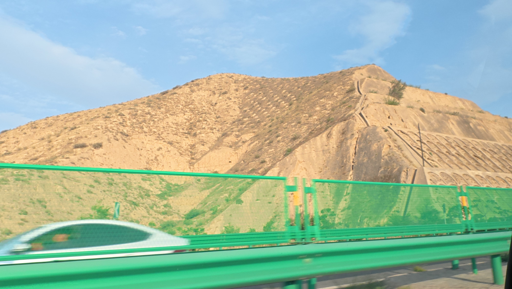
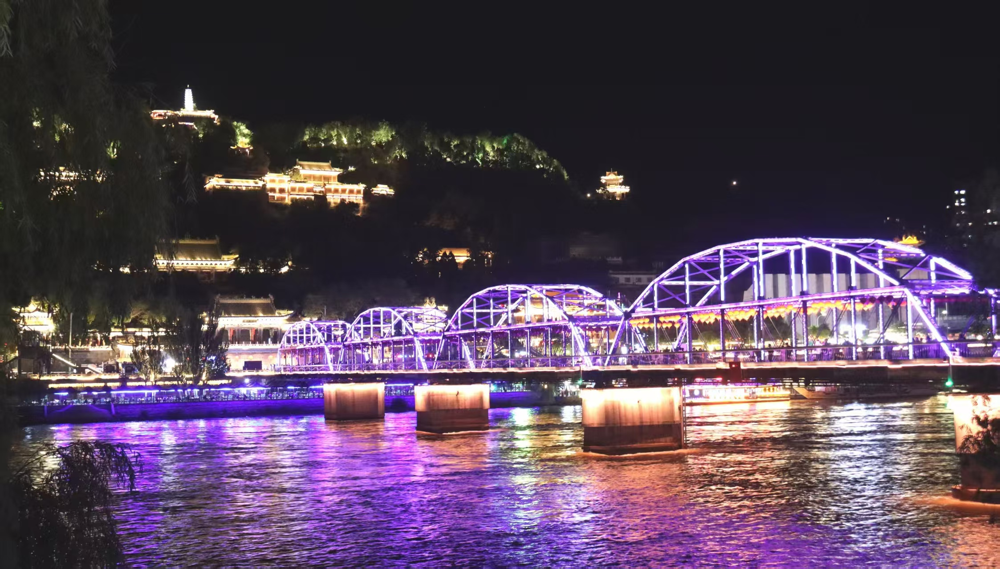

今天早上从萧山机场附近的欢迎酒店起来的时候，已经挺晚了，因为我原先是 12 点的飞机嘛。然后我起来的时候，其实已经是九点多了。整理一下差不多十点多了。最让我感到郁闷的是，我去把我的衣服拿去洗嘛，然后我发现洗的话需要好久，在那里的时间好长。本来我是打算洗完就走的，但是因为我是第一次坐飞机，所以我就想着提早一点。我因为洗衣服这件事一直拖到了十点多，快十一点。

然后我又担心赶不上飞机嘛，所以我就把原来的那一趟改签了，把那个时间改到了下午 2 点的飞机。结果我从酒店出发到 T 三航站楼，领取值机牌、过安检、到登机口，总共花了三十分钟都没有。因为这个改签直接造成我四百四十块钱直接损失打水漂。这是我今天早上遇到的最郁闷的事情了。

然后我去过安检的时候，我发现那些工作人员搜查的都很仔细，比高铁要仔细得多。因为这是我第一次登机嘛，第一次坐飞机，所以我第一次坐上飞机的时候，感觉还是有点新奇的。然后飞机起飞的话，其实觉得还好，就有点像坐过山车。不过飞机上空姐的服务态度那是真的特别好，跟高铁上完全是两回事。而且飞机上有餐饮，还有免费的饮料和水。虽然说这个餐饮可能不是特别好吧，但有总比没有好。

在飞机起飞的时候，那种燃油味道特别的重，特别难闻。然后起飞之后，在空中飞行的时候，两侧的那种噪音非常的大。不过如果把它当成白噪音的话，其实还可以，而且感觉有点犯困。飞机上那个座位其实没有像网友说的那样逼仄。脚还是能伸直的。

感受最深的其实还是降落那个阶段，准备降落以及即将降落的时候，飞机颠簸得特别厉害，一直在晃动。所以我觉得很多东西，照片是照片，视频是视频，听别人说又是听别人说，还是要自己去亲身经历一下的。不管是第一次坐飞机也好，还是第一次长途跋涉。整个坐飞机没有我想的那么坎坷，流程也比较快，也没有我想的那么麻烦。

而且现在基本上有啥不懂的、不理解的，问工作人员或者按照地标走，都能掌握得七七八八。我到达兰州之后，从中川机场下来，我感受最深的是北方这边特别的荒芜。特别的广阔，如果按我的感受用一个字去描述的话，就是“阔”。

兰州这边的山，它不像我们江西。我们江西其实也有那种连绵不绝的小山丘，但它那上面基本上都会有草木，有树木。这边的话，一眼望过去全是黄土，整的很荒芜。

但是从另一方面来讲，我觉得这种宽广的场景能够让我的心情放松下来。说起来我不知道为什么对比于城市的高楼林立，我更喜欢田野的这种宽广辽阔。而且我总感觉在北方这边的天空，它的饱和度有点高，跟南方那种灰蒙蒙的感觉相比，北方的天空特别的鲜艳。

然后我打车也是花了将近一个小时多到达我定的酒店。然后其实说实话，我到酒店的时候已经很累了。五点十分左右到达中川机场，然后六点七点左右到达酒店，酒店再搞搞已经八九点了，吃了点饭，已经是九点多了。然后又去了那个中山桥去看了一下。那个中山桥我觉得挺好看的。它那个景色怎么说呢？就是你从远近看过去的话，它很多的这个楼都排列在山上，那种感觉很壮观。

特别是那里的灯光，给人的感觉就是很恢宏。
