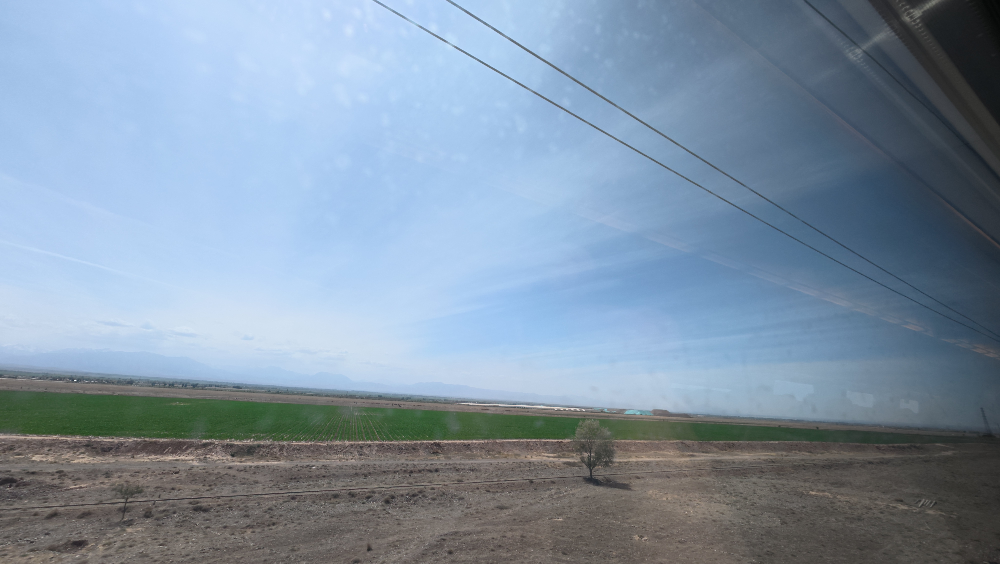

今天我早上醒来的还挺早。本来打算早上起来跑个步的。结果连五百米都没有跑到，就感觉跑不动了，气喘吁吁的。不知道是不是很久没跑了，还是什么原因。

我是早上 9 点多快 10 点出发去的兰州西站。兰州西站离我的那个酒店还挺近的，走路过去差不多 20 多分钟就到了。然后我在那里等车等了两个小时，从十二点五十九上车。在车上一直坐了七个多小时。

真的，我感觉这个时间特别的漫长。而且车上还经常没网，车厢附近还很吵。所以我当时的感受就是又吵、又困、又累、又难受。

不过这一路火车给我最大的感受还是沿途中的风景。从兰州出发到敦煌，中间依次经过了草原、戈壁，还有森林。特别是草原，北方给我的感觉真的就是特别的宽阔、广阔。而且从远处看过去，你可以看到层次非常的分明，上面是蓝色的天空，再下来是远景延绵不断的山，再往下一层就是草原，再往下近处就是火车的铁轨和一些标志牌。

不仅如此，北方如果乌云密布的话，又是另一种景色。它不像南方那样，非常的压抑。相反，虽然说有乌云，但是依旧感觉天和地面离得特别的高。而且如果中间有一些水汽的话，就会有一种朦朦胧胧的感觉，跟起雾一样。不过一般情况下都是开太阳的，太阳特别的大。那种景色就是非常像宣传片里面宣传的天空、草原、草原上面有一些牛羊。

然后再让我感觉到比较震撼的就是这边的戈壁。这边的戈壁真的给人一种非常荒芜、非常死寂的感觉。一眼望过去，除了黄沙黄土，就几乎没有什么东西了。而且我觉得这里的景色非常好的一点在于，它仅靠几个线条就把层次给勾勒了出来。同时通过一些稀疏的、零星的植被进行点缀。给人一种即使在充满死寂的环境中，也能出现生命，也能出现生机的感觉。

从这些自然景象中，我明白了，好的视觉设计可能并不需要很多复杂的、花哨的元素。保持结构清晰、层次明显。通过线条去引导用户的视觉。用户的视线可以通过线条延绵至远方，或者通过线条进行一定的引导。

这是我这次旅途看这个风景时最大的收获。虽然说七个小时真的很长，而且我真的很累。到敦煌，从敦煌站出来的时候，特别特别的晒。这种晒跟南方完全不一样。我到敦煌的时候已经差不多七点半了。然后打一个出租车到我订的酒店，差不多已经快八点了。晚上的话，我又去了上元市集那里去逛了一下。这里的景色也很不错，灯火通明的，我不知道是不是我的错觉，我总感觉北方的人比南方人好像更开朗、更外向一点。不管是我在这边遇到的商贩啊，还是在这边遇到的民宿的老板娘，我觉得她们都特别的开朗。这点挺让我感到好感的，其实我特别喜欢北方这种开朗的性格，不藏着掖着。我觉得南方的人就是太拘束，太含蓄了，这点我非常的不喜欢。当然有可能跟我的直男性格有关吧。

反正到目前为止，在这边给我的感觉还是很不错的，不管是这个风景呀、文化呀，还是人文，都给我带来很大的好感。唯一有点难受的可能就是路程有点远，然后赶车的话太累。
